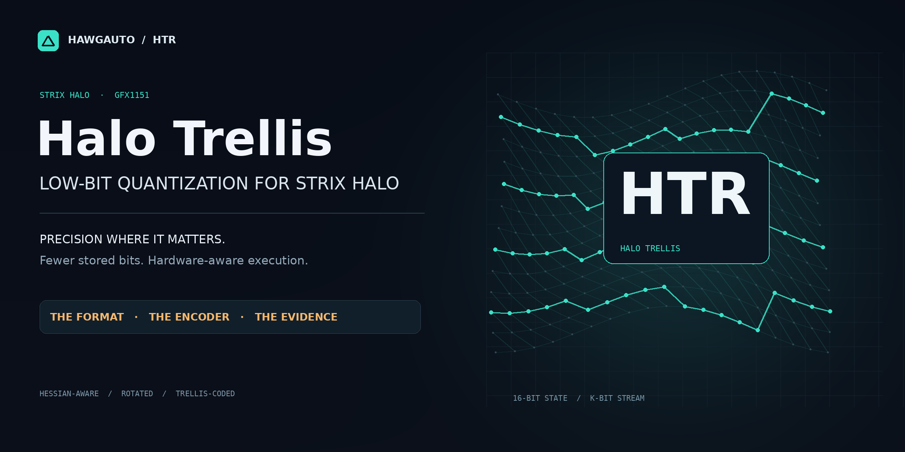
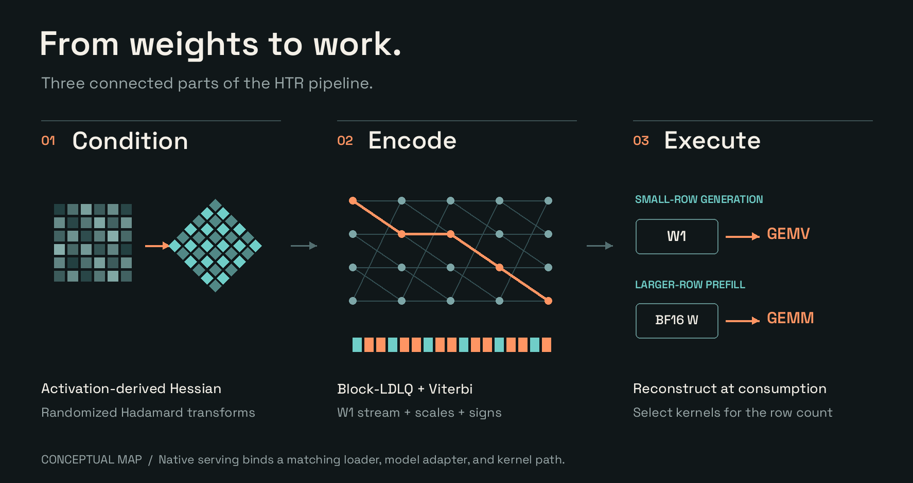
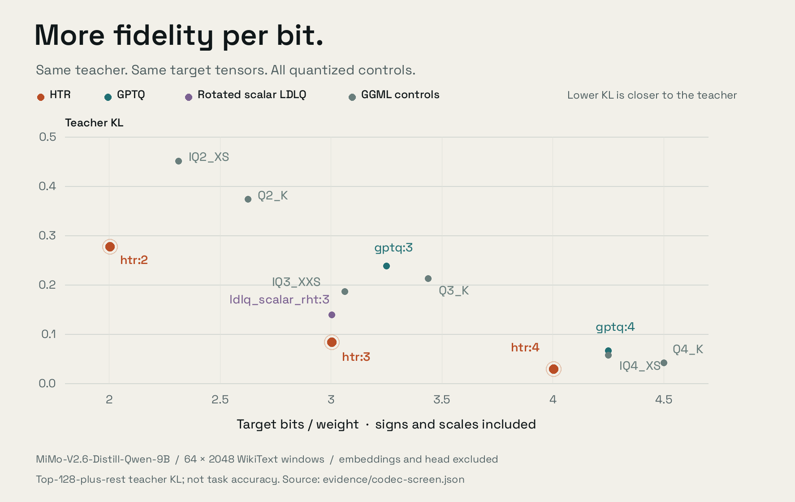

# HTR — Halo Trellis (`v0.2.0`)

**HTR v0.2.0 — Low-bit weight quantization built for AMD Strix Halo.**

HTR combines Hessian-aware encoding, rotated trellis quantization, and hardware-oriented GPU kernels to preserve model fidelity while storing and moving fewer weight bytes. It brings the codec, encoder, packed format, and execution path together around the Radeon 8060S's shared-memory architecture.

The goal is practical: **more model in memory, less weight traffic per generated token, and precision where it matters.**

HTR was inspired by exlr8 and builds on work by the ExLlamaV3/EXL3, QTIP, QuIP/QuIP#, and GPTQ/LDLQ authors. We gratefully acknowledge that foundation; our [lineage and technical differences](docs/LINEAGE.md) explain how HTR specializes the codebook, checkpoint format, and execution path for Strix Halo.

[What's new in v0.2.0](#whats-new-in-v020) · [Findings & evidence](docs/EVIDENCE.md) · [How it works](docs/METHODOLOGY.md) · [Get started](docs/USAGE.md) · [Format specification](docs/FORMAT.md)

## What's new in v0.2.0

`v0.2.0` upgrades the encoder's quality, speed, MoE calibration, and cache/reader safety while keeping the **HTR-W1 wire format and `rdna24` decoders 100% unchanged and backward-compatible**:

| Improvement | Measured impact | How to use |
|---|---|---|
| **QTIP tail-biting seam (new CLI default)** | **−9.12%** matrix proxy error (200/200 MiMo-9B K3 matrices) and **−8.02% teacher KL** (`[-11.02%, -5.30%]`) at identical wire bytes *(old-seam control retained slightly lower corpus PPL; see [component status](docs/RELEASE_STATUS.md))* | Default in `htr.quantize`; pass `--seam htr` for legacy compatibility. Also opt-in via `--seam qtip` on `htr.encode_q38` and `htr.moe_encode`. |
| **Wave-cooperative Viterbi + GPU backtrack (`htr/vit_v2.py`)** | **100% bit-identical** to `k_group` with measured Radeon 8060S (`gfx1151`) full-encode wall speedups of **~1.20× (K3)**, **~1.48× (K4)**, and **~2.90× (K5)** (zero scratch spills, halved SGPRs, single-launch GPU backtracking & in-place tail-biting mask, trimmed pass-1 buffers) | Automatic on `gfx1151` via `viterbi_auto`; override anytime with `HTR_VITERBI_IMPL=group` or `impl=`. |
| **Opt-in fixed-path FP16 row-scale refit (`htr/scale_refit.py`)** | Refits FP16 row scales post-encode without altering codes or signs; default OFF on dense encodes (where dense QTIP+refit did not improve KL/PPL), beneficial on MoE experts | Pass `--scale-refit` (K2–K5) on `htr.quantize`, `htr.encode_q38`, or `htr.moe_encode` (recipe-safe cache/resume). |
| **Router-weighted MoE Hessians (`htr/moe_encode.py`)** | Streaming FP32 `softp` + `--scale-refit` reduced held-out routed-expert squared output error by **−11.23% (K4)** and **−11.29% (K5)** vs hard routing (30/32 experts improved on the Qwen3.8 L2 testbed) | Opt-in `--hessian-mode {hard,softp,shrink}` (default `hard`, `--shrink-n0 1024`). |
| **Cache provenance & reader-identity hardening** | Dense caches verify group seed/signs and SHA-256 weight/Hessian digests (**17.9 s** across 41.4 GiB on MiMo-9B); `htr.vllm_plugin` fails closed on non-`HTR-W1`/`rdna24` declarations; canonical layer-dir Hessian binding | Automatic on new dense caches; pass `--require-cache-inputs` to refuse unverified legacy caches. |
| **Expanded verification** | **131 CPU regression tests** (up from 7) covering codec, seam, scale refit, cooperative dispatch, cache identity, reader guards, and Q38/MoE adapters | `python -m unittest discover -s tests -v` |

See [component status](docs/RELEASE_STATUS.md) for the full v0.2.0 release notes and verified boundaries.

## What HTR brings

- **A useful low-bit range.** K2–K5 trellis streams support different size/fidelity budgets, with per-tensor policies and retained-precision tensors where needed.
- **Calibration-aware fidelity.** Randomized Hadamard transforms condition the weights; block-LDLQ feedback and tail-biting Viterbi search choose an encoding that accounts for the model's activation statistics.
- **Compact, explicit storage.** HTR-W1 stores K bits per weight plus row scales and packed signs. Circular streams avoid a separate initial-state record for every tile.
- **RDNA-oriented reconstruction.** The RDNA24 procedural codebook reconstructs values with integer multiply/add and byte-sum operations rather than a large per-weight codebook lookup.
- **Packed execution for small batches.** HIP kernels reconstruct weights as they consume them, keeping the low-bit representation on the generation path instead of maintaining a full BF16 weight expansion.
- **An inspectable toolchain.** CPU reference code, CUDA/HIP encoder sources, checkpoint tools, native kernel sources, format documentation, tests, and saved experimental data are all here.



## Findings at a glance

The measurements below come from our published [dense 9B case study](docs/case-studies/dense-9b.md). They illustrate the design's benefits with explicit controls and workloads.

| Finding | Measured result | Why it matters |
|---|---|---|
| Better fidelity per bit in the codec screen | K4 HTR: **56.10% lower teacher KL** at **5.80% fewer target bits** than the tested GPTQ4-g128 control | Lower teacher divergence without buying it with a larger target representation |
| Higher fidelity at the same bit budget | K3 HTR: **40.03% lower teacher KL** than the rotated scalar LDLQ control, both at **3.003299 target bpw** | Improves on a rotation-and-feedback scalar baseline without more target bits |
| Fidelity survives packing | K4 trunk + K4 head: packed **PPL 9.047606**, compared with **9.019484** for the BF16 teacher and **9.048045** for the fake-quantized reconstruction | The real packed checkpoint closely tracks the encoder's reconstruction |
| Faster generation on Radeon 8060S | K4/K4-head and K3/K4-head achieved **3.14× / 3.75×** the BF16 wall-generation rate in the recorded single-sequence test | Fewer weight bytes translated into an end-to-end generation benefit on the target hardware |

Teacher KL measures distribution fidelity, not task accuracy; target bpw covers the quantized subset. The serving results are historical, use a 16-token prompt and 256 output tokens, and include prompt time. Prefill was slower in that test. [Full conditions, all controls, repetitions, and current verification scope](docs/EVIDENCE.md) are published alongside the results.



[Explore the chart and full measurements →](docs/EVIDENCE.md)

## Where HTR fits best

**Bandwidth-bound local generation.** When reading weights dominates a small-batch decode step, compact storage and fused reconstruction can reduce the work spent moving those weights.

**Memory-constrained model deployment.** Large matrices need only a small sign/scale overhead beyond their nominal K-bit streams. Tensor-level policy keeps sensitive or unsupported components in a suitable representation rather than forcing one precision everywhere.

**Quantization and runtime development.** The reference implementation and explicit wire format let you inspect an encoding, check reconstruction, measure the result, and build a consuming runtime against a defined contract.

## Get started

Use a Python environment with PyTorch, Safetensors, and Transformers installed for your platform. Keep your existing platform-specific ROCm/CUDA PyTorch build.

```bash
git clone https://github.com/HawgAuto/HTR.git
cd HTR
python -m pip install --no-build-isolation --no-deps .
python -m unittest discover -s tests -v
python -m htr.quantize --help
```

All **131 CPU tests** run without a GPU and include a real matrix encode → safetensors → reopen → decode round trip. [Usage](docs/USAGE.md) covers the matrix API, checkpoint encoding, calibration, output heads, and architecture-specific adapters.

**Current release: v0.2.0.** The repository includes experimental packed-linear/vLLM integration; a supported HTR loader is required for model serving. See [component status](docs/RELEASE_STATUS.md) for the verified paths and native-runtime work. Model weights and calibration datasets are not bundled.

## Explore the implementation

| Area | Entry points |
|---|---|
| W1 packing, codebook, transforms, reference decoding | [`htr/wire.py`](htr/wire.py) · [Format](docs/FORMAT.md) |
| Hessian-aware grouping, encoding, and scale refit | [`htr/encode.py`](htr/encode.py) · [`htr/scale_refit.py`](htr/scale_refit.py) · [Methodology](docs/METHODOLOGY.md) |
| Reference and cooperative Viterbi search | [`htr/reference.py`](htr/reference.py) · [`htr/vit_v2.py`](htr/vit_v2.py) |
| Checkpoint conversion, heads, and MoE/Q38 adapters | [`htr/quantize.py`](htr/quantize.py) · [`htr/lmhead.py`](htr/lmhead.py) · [`htr/encode_q38.py`](htr/encode_q38.py) · [`htr/moe_encode.py`](htr/moe_encode.py) |
| Packed-linear execution and vLLM plugin | [`htr/ops.py`](htr/ops.py) · [`htr/csrc/`](htr/csrc/) · [`htr/vllm_plugin.py`](htr/vllm_plugin.py) |
| Results and reproducible checks | [Findings](docs/EVIDENCE.md) · [Case study](docs/case-studies/dense-9b.md) · [`evidence/`](evidence/) · [`tests/`](tests/) |

## Acknowledgments and license

See [Lineage and acknowledgments](docs/LINEAGE.md) for upstream credits and source-reuse disclosures, and [HTR versus EXL3](docs/LINEAGE.md#htr-and-exl3-what-actually-differs) for the codebook, format, and RDNA execution differences.

HTR code is [MIT licensed](LICENSE). [Third-party notices](THIRD_PARTY_NOTICES.md) and source-model licenses retain their own scope. [Artwork, chart sources, and typography](media/README.md).
