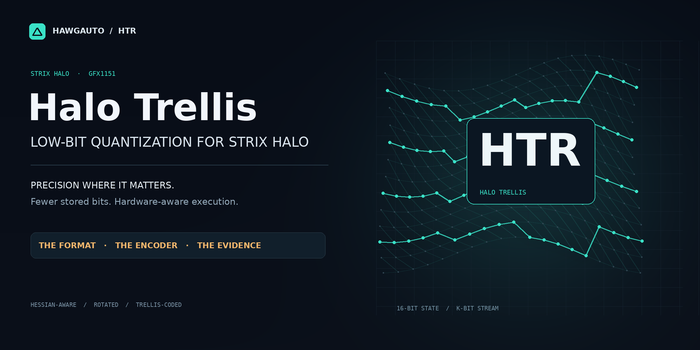

# HTR — Halo Trellis

**Low-bit weight quantization built for AMD Strix Halo.**

HTR combines Hessian-aware encoding, rotated trellis quantization, and hardware-oriented GPU kernels to preserve model fidelity while storing and moving fewer weight bytes. It brings the codec, encoder, packed format, and execution path together around the Radeon 8060S's shared-memory architecture.

The goal is practical: **more model in memory, less weight traffic per generated token, and precision where it matters.**

[Findings & evidence](docs/EVIDENCE.md) · [How it works](docs/METHODOLOGY.md) · [Get started](docs/USAGE.md) · [Format specification](docs/FORMAT.md)

## What HTR brings

- **A useful low-bit range.** K2–K5 trellis streams support different size/fidelity budgets, with per-tensor policies and retained-precision tensors where needed.
- **Calibration-aware fidelity.** Randomized Hadamard transforms condition the weights; block-LDLQ feedback and Viterbi search choose an encoding that accounts for the model's activation statistics.
- **Compact, explicit storage.** HTR-W1 stores K bits per weight plus row scales and packed signs. Circular streams avoid a separate initial-state record for every tile.
- **RDNA-oriented reconstruction.** The RDNA24 procedural codebook reconstructs values with integer multiply/add and byte-sum operations rather than a large per-weight codebook lookup.
- **Packed execution for small batches.** HIP kernels reconstruct weights as they consume them, keeping the low-bit representation on the generation path instead of maintaining a full BF16 weight expansion.
- **An inspectable toolchain.** CPU reference code, CUDA/HIP encoder sources, checkpoint tools, native kernel sources, format documentation, tests, and saved experimental data are all here.

## Findings at a glance

The measurements below come from our published [dense 9B case study](docs/case-studies/dense-9b.md). They illustrate the design's benefits with explicit controls and workloads.

| Finding | Measured result | Why it matters |
|---|---|---|
| Better fidelity per bit in the codec screen | K4 HTR: **56.10% lower teacher KL** at **5.80% fewer target bits** than the tested GPTQ4-g128 control | Lower teacher divergence without buying it with a larger target representation |
| Higher fidelity at the same bit budget | K3 HTR: **40.03% lower teacher KL** than the rotated scalar LDLQ control, both at **3.003299 target bpw** | Improves on a rotation-and-feedback scalar baseline without more target bits |
| Fidelity survives packing | K4 trunk + K4 head: packed **PPL 9.047606**, compared with **9.019484** for the BF16 teacher and **9.048045** for the fake-quantized reconstruction | The real packed checkpoint closely tracks the encoder's reconstruction |
| Faster generation on Radeon 8060S | K4/K4-head and K3/K4-head achieved **3.14× / 3.75×** the BF16 wall-generation rate in the recorded single-sequence test | Fewer weight bytes translated into an end-to-end generation benefit on the target hardware |

Teacher KL measures distribution fidelity, not task accuracy; target bpw covers the quantized subset. The serving results are historical, use a 16-token prompt and 256 output tokens, and include prompt time. Prefill was slower in that test. [Full conditions, all controls, repetitions, and current verification scope](docs/EVIDENCE.md) are published alongside the results.

## Where HTR fits best

**Bandwidth-bound local generation.** When reading weights dominates a small-batch decode step, compact storage and fused reconstruction can reduce the work spent moving those weights.

**Memory-constrained model deployment.** Large matrices need only a small sign/scale overhead beyond their nominal K-bit streams. Tensor-level policy keeps sensitive or unsupported components in a suitable representation rather than forcing one precision everywhere.

**Quantization and runtime development.** The reference implementation and explicit wire format let you inspect an encoding, check reconstruction, measure the result, and build a consuming runtime against a defined contract.

## Get started

Use a Python environment with PyTorch, Safetensors, and Transformers installed for your platform. Keep your existing platform-specific ROCm/CUDA PyTorch build.

```bash
git clone https://github.com/HawgAuto/HTR.git
cd HTR
python -m pip install --no-build-isolation --no-deps .
python -m unittest discover -s tests -v
python -m htr.quantize --help
```

The tests run on CPU and include a real matrix encode → safetensors → reopen → decode round trip. [Usage](docs/USAGE.md) covers the matrix API, checkpoint encoding, calibration, output heads, and architecture-specific adapters.

**Current release: v0.1.0rc1, codec and encoder source preview.** The repository includes experimental packed-linear/vLLM integration; a supported HTR loader is required for model serving. See [component status](docs/RELEASE_STATUS.md) for the verified paths and native-runtime work. Model weights and calibration datasets are not bundled.

## Explore the implementation

| Area | Entry points |
|---|---|
| W1 packing, codebook, transforms, reference decoding | [`htr/wire.py`](htr/wire.py) · [Format](docs/FORMAT.md) |
| Hessian-aware grouping and encoding | [`htr/encode.py`](htr/encode.py) · [Methodology](docs/METHODOLOGY.md) |
| Reference and accelerated Viterbi search | [`htr/reference.py`](htr/reference.py) · [`htr/vit_v2.py`](htr/vit_v2.py) |
| Checkpoint conversion and head calibration | [`htr/quantize.py`](htr/quantize.py) · [`htr/lmhead.py`](htr/lmhead.py) |
| Packed-linear execution and integration | [`htr/ops.py`](htr/ops.py) · [`htr/csrc/`](htr/csrc/) · [`htr/vllm_plugin.py`](htr/vllm_plugin.py) |
| Results and reproducible checks | [Findings](docs/EVIDENCE.md) · [Case study](docs/case-studies/dense-9b.md) · [`evidence/`](evidence/) · [`tests/`](tests/) |

## Acknowledgments and license

HTR builds on work by the exlr8, ExLlamaV3/EXL3, QTIP, QuIP/QuIP#, and GPTQ/LDLQ authors, alongside the AMD and open-source inference communities. Our [acknowledgments](docs/LINEAGE.md) document that lineage and the HTR-specific engineering in detail.

HTR code is [MIT licensed](LICENSE). [Third-party notices](THIRD_PARTY_NOTICES.md) and source-model licenses retain their own scope.
