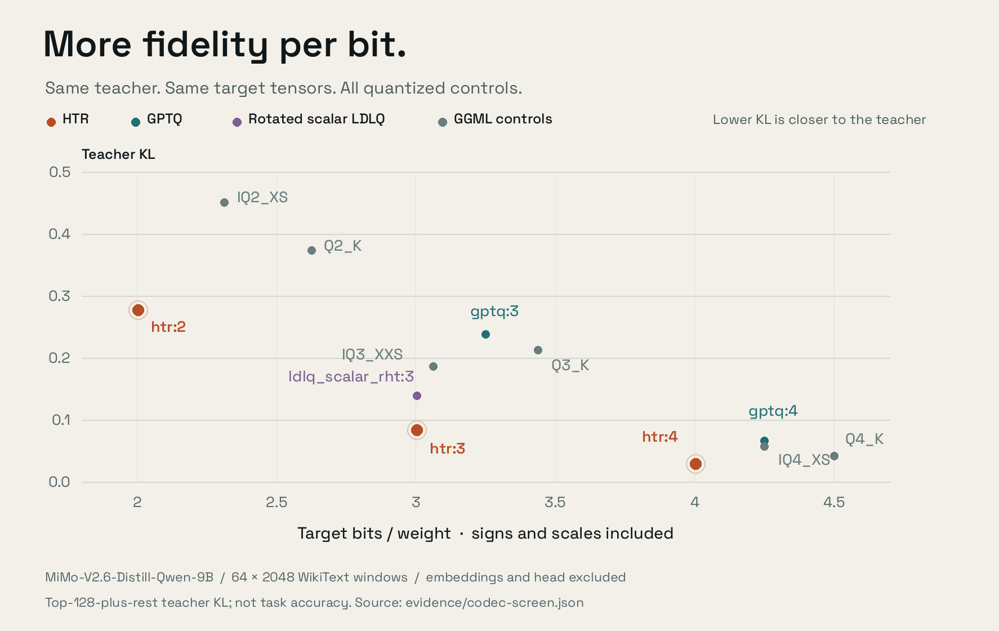
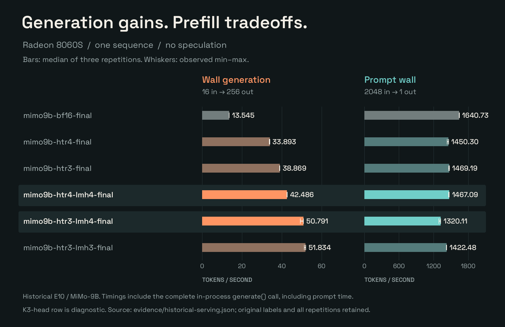

# HTR findings and evidence

HTR's results connect three questions: **how much fidelity fits in a bit budget, whether the packed artifact preserves that fidelity, and whether fewer weight bytes improve execution.** This page presents the findings; the [dense 9B case study](case-studies/dense-9b.md) contains the complete model-specific tables and conditions.

The current public model dataset is from MiMo-V2.6-Distill-Qwen-9B. Codec and packed-quality evaluations use 64×2048 held-out WikiText windows, with 131,008 scored tokens. Serving measurements use Radeon 8060S. The observations below retain their own measurement scopes rather than combining different tests into a single product score.

## 1. More fidelity per target bit

The codec screen compares the same target tensors against the same BF16 teacher. Embeddings and the output head are outside this target subset. HTR combines the rotated representation and block-LDLQ feedback with a trellis search over valid code sequences.

| Comparison | HTR target bpw | Control target bpw | HTR teacher KL | Control teacher KL | Lower KL | Fewer target bits |
|---|---:|---:|---:|---:|---:|---:|
| `htr:4` / `gptq:4` | 4.003299 | 4.250000 | 0.028893 | 0.065814 | 56.10% | 5.80% |
| `htr:3` / `gptq:3` | 3.003299 | 3.250000 | 0.082963 | 0.237551 | 65.08% | 7.59% |
| `htr:3` / `ldlq_scalar_rht:3` | 3.003299 | 3.003299 | 0.082963 | 0.138338 | 40.03% | 0.00% |

The same-budget comparison shows HTR improving teacher fidelity against a scalar control that already uses rotation and LDLQ feedback. It is a direct result for the tested trellis-based encoding pipeline at matched target bitrate.

**Metric:** teacher KL here is top-128-plus-rest coarsened divergence, a lower bound on full-vocabulary KL. Lower means closer to the teacher distribution. PPL and task accuracy are different measures; the [full control table](case-studies/dense-9b.md#codec-screen-e08) retains PPL and top-1 agreement, including controls with better PPL.

Source: [`codec-screen.json`](../evidence/codec-screen.json). Percentage reductions are calculated from the full-precision rows, not the rounded display values.



## 2. Low overhead beyond the nominal bit width

W1 stores a K-bit stream plus one FP16 scale per output row and packed input/output signs. For an `m × n` matrix:

```text
payload bytes = m*n*K/8 + 2*m + n/8 + m/8
effective bpw = K + 16/n + 1/m + 1/n
```

For a **4096×4096 matrix**, including those scales and signs:

| Width | W1 payload bytes | Effective bpw | BF16 bytes / W1 bytes |
|---|---:|---:|---:|
| K2 | 4,203,520 | 2.004395 | 7.98× |
| K3 | 6,300,672 | 3.004395 | 5.33× |
| K4 | 8,397,824 | 4.004395 | 4.00× |
| K5 | 10,494,976 | 5.004395 | 3.20× |

This is exact format accounting with rounded ratios, not a whole-model measurement. Checkpoint headers, retained-precision tensors, runtime layouts, KV cache, and workspaces are separate. The practical result is that large supported matrices stay close to their nominal bitrate. See the [wire specification](FORMAT.md) and [tensor-policy methodology](METHODOLOGY.md#7-tensor-policy-precision-where-it-matters).

## 3. Packed checkpoints track the encoder's reconstruction

The packed-artifact evaluation includes a separately encoded K4 output head. The K4 trunk + K4 head achieved **PPL 9.047606**, against **9.019484** for its same-process BF16 teacher; the fake-quantized reconstruction measured **9.048045**. Packed teacher KL was **0.030529**, compared with **0.030586** for the fake-quantized reconstruction.

This closes an important gap between a quantizer experiment and a stored artifact: the packed representation retains the measured model fidelity closely. The K3 candidate and the exact BF16 repeat controls are also included in the [complete packed table](case-studies/dense-9b.md#packed-checkpoint-fidelity-e10).

Source: [`packed-quality.json`](../evidence/packed-quality.json). These whole-model evaluation results are close, not bit-identical; the CPU serialization test separately checks exact reconstruction of its encoded matrix.

## 4. Fewer weight bytes can improve generation substantially

The historical Radeon 8060S test measured one sequence, no speculation, prefix cache off, and three repetitions per configuration. Generation used 16 input tokens and 256 forced output tokens. The separate prompt test used 2048 input tokens and one output token.

| Original label | Median wall-generation tok/s | Relative to BF16 | Median prompt-wall tok/s |
|---|---:|---:|---:|
| `mimo9b-bf16-final` | 13.545 | 1.00× | 1640.73 |
| `mimo9b-htr4-lmh4-final` | 42.486 | 3.14× | 1467.09 |
| `mimo9b-htr3-lmh4-final` | 50.791 | 3.75× | 1320.11 |

The generation benefit is a measured execution result, not an inference from file size. It also shows why HTR treats decode and prefill separately: the prompt-wall rates fell by **10.58%** and **19.54%** for these two configurations, respectively.

Both metrics include the complete in-process `generate` call: generation includes its short prompt, and prompt-wall includes its one-token completion. They are not pure device timers or HTTP throughput. The [case study](case-studies/dense-9b.md#radeon-8060s-serving-e10) retains every configuration and links every repetition; [`historical-serving.json`](../evidence/historical-serving.json) records the runtime and sampling settings.



## 5. An executable, inspectable reference

The source-preview CPU suite covers independent K2–K5 bitstream decoding, sign packing, Hadamard inversion, a self-contained circular-state Viterbi path, native-source inclusion, path portability, and a real encode → safetensors → reopen → decode round trip.

Run it with:

```bash
python -m unittest discover -s tests -v
```

The seven tests validate the reference/packaging boundary. Historical full-model measurements remain associated with their recorded runtime; native qualification of the distributable integration is tracked in [release status](RELEASE_STATUS.md).

## Using these findings

The strongest demonstrated fit is **compact weights plus improved generation in a bandwidth-sensitive local workload**, with better teacher fidelity per bit than the specific tested codec controls. Choose widths and retained-precision tensors using model-level evaluation, and measure prefill and generation separately on the intended runtime. Wider model coverage and task-specific evaluations extend this evidence; they are not assumed from it.
