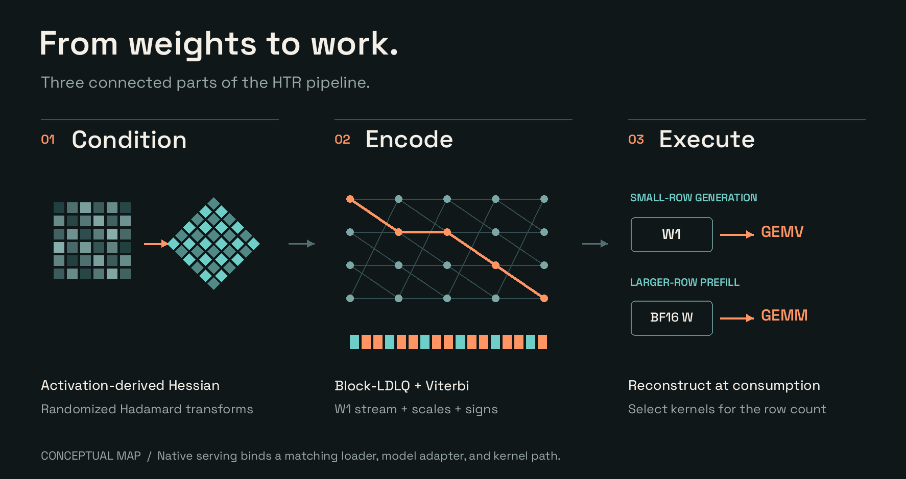

# HTR methodology: Halo Trellis

HTR co-designs low-bit weight storage, calibration-aware encoding, and GPU execution for AMD Strix Halo. Its practical focus is fidelity per bit and useful inference performance: condition the weights, encode them as compact trellis streams, and reconstruct values efficiently where the GPU consumes them.

This document explains the design from activation statistics to kernel behavior. See [findings and evidence](EVIDENCE.md) for measured outcomes and [acknowledgments](LINEAGE.md) for the research and engineering lineage.

## 1. What problem are we solving?

At low batch size, an integrated GPU often spends much of a decode step reading weights from shared memory. Reducing the stored bytes can reduce that traffic and let a larger checkpoint fit. But it helps only if decoding the compressed representation, rotating activations, and scheduling the work do not consume the savings.

The design balances:

- fidelity to the source model, measured on held-out data;
- actual packed bytes, including scales, signs, padding, and untouched tensors;
- bytes read by the active dense and routed matrices per token;
- end-to-end prefill and generation behavior on the intended hardware.

HTR is lossy weight quantization. “Precision” in our comparisons means measured reconstruction/model fidelity at a storage budget, not recovering BF16 exactly or doing native three-/four-bit floating-point arithmetic.

## 2. Rotate before quantizing

For a matrix `W` with shape `[m output, n input]`, the W1 encoder uses block-diagonal, normalized 128-point Hadamard transforms on both axes, with reproducible random sign vectors:

    W_rot = H_out · diag(sv) · W · diag(su) · H_in
    W_hat = diag(sv) · H_out · Q_hat · H_in · diag(su)

Here the Hadamard blocks are symmetric and orthogonal. Without quantization, the forward/inverse transforms preserve the matrix up to floating-point rounding. They spread concentrated/outlier energy across coordinates so that a common codebook is more useful. This is statistical conditioning, not a guarantee that every tensor becomes Gaussian.

The input Hessian is transformed into the same coordinates. Fused projections that consume the same activation share input signs and a compatible width. That is important for a runtime which concatenates Q/K/V or gate/up matrices: incompatible input transforms cannot be silently fused.

W1 requires both dimensions to be divisible by 128. The generic checkpoint encoder leaves unsupported dimensions and excluded tensor families in their source representation. An escape is a deliberate retained-precision tensor, not a failed quantization silently mislabeled as HTR.

## 3. Calibration and block-LDLQ error feedback

Calibration observes the real model's inputs to each target linear and estimates

    H = E[x xᵀ]
    output-error proxy = tr((W - W_hat) H (W - W_hat)ᵀ).

This proxy values errors along frequently used input directions more heavily. It is not an exact task loss or a substitute for full-model evaluation.

The implementation regularizes the rotated Hessian, handles dead input directions, and uses a Cholesky-derived block-LDL factorization with 16-column blocks. It walks from the last input block toward the first, adding feedback from already-encoded blocks to the next block's target. The feedback lets errors in correlated directions partly compensate one another.

Within a tile, the released dense encoder's Viterbi objective uses the per-row scale-squared weighting; it does not solve an arbitrary full covariance objective inside every 16×16 tile. This approximation and the blockwise feedback should not be described as a globally optimal quantizer.

Calibration is part of the artifact identity: source checkpoint, tensor selection, corpus, windows, seeds, damping, group construction, and widths all matter. Encoding the same model with different calibration is a different experiment. The low-bit module metadata is not a promise that generic calibration reproduces a published model byte for byte.

## 4. Trellis coding: a sequence, not independent scalar levels

A tile contains 16×16 weights, read in output-row-major order. Its packed stream contains exactly `256 × K` bits. A 16-bit state evolves as

    s[t] = ((s[t-1] << K) & 0xffff) | new_bits[t].

Each reconstructed weight depends on a sliding 16-bit window of the circular stream. Adjacent weights share state, so they cannot be selected independently. Viterbi search chooses a low-error valid sequence rather than independently picking one of `2^K` scalar levels for each weight.

A large state space does not imply storing 16 bits per weight. Only K new bits per step are stored. Conversely, many reachable states do not mean every weight can independently choose any codebook entry.

The two-pass tail-biting implementation first estimates a boundary state, then reruns with a compatible boundary constraint. This closes the circular stream without storing an initial state for each tile. It is a practical boundary-selection procedure, not an exhaustive proof of the globally best tail-biting boundary.

## 5. RDNA24 procedural codebook

W1 uses the following fixed integer generator:

    x = (s × 0xDF6ADF + 0x34983) mod 2^32
    v(s) = sum_of_four_unsigned_bytes(x) - 510
    cb(s) = float32(v(s) / RMS_over_all_65536_states(v)).

The encoder normalizes each rotated output row and stores its scale as FP16. The decoder reconstructs the selected codebook value and applies the row scale.

This generator fits RDNA-oriented integer multiply/add and byte-sum operations. The fused decoder computes the codebook value from the state, avoiding a large per-weight codebook load and requiring no FP8 tensor-core execution. A K4 trellis stream stores four new bits per weight while reconstructing values from the larger state-dependent codebook.

The generator is an integer-lattice construction before normalization, but this does not make the serving operation “native INT4” or “native FP4.” Small-row HTR kernels reconstruct values and use floating-point dot-pair arithmetic and accumulation. The compressed representation, reconstruction precision, activation precision, and arithmetic instruction are distinct.

## 6. Exact W1 storage and bits per weight

Each quantized `[m,n]` matrix contains:

| Tensor | Stored type | Shape | Purpose |
|---|---|---|---|
| `htr_qweight` | INT32 bit patterns | `[m/16,n/16,8K]` | MSB-first circular trellis streams |
| `htr_scales` | FP16 | `[m]` | One rotated-row scale |
| `htr_su` | UINT8 | `[n/8]` | Packed input signs; LSB-first; bit 1 means −1 |
| `htr_sv` | UINT8 | `[m/8]` | Packed output signs; same convention |

The payload cost, before safetensors headers or runtime repacking, is

    bytes = m*n*K/8 + 2*m + n/8 + m/8
    effective bpw = K + 16/n + 1/m + 1/n.

Signs and scales are not free. Their overhead is small for large matrices, but whole-checkpoint bitrate also includes embeddings, norms, small escaped projections, vision components if retained, metadata, and any draft or lookup tables. A report's `target_bpw` must never be presented as whole-model bitrate.

K2–K5 is the practical HTR family selected by this work. The low-level W1 routines can represent additional integer widths, but K6/K8 experiments did not justify making them recommended products; higher-precision scalar/GPTQ escapes can be preferable. Wider trellis coding is not automatically better than a good scalar quantizer at the same storage budget.

See [FORMAT.md](FORMAT.md) for the serialization contract.

## 7. Tensor policy: precision where it matters

A useful model policy distinguishes tensor roles instead of assigning one width indiscriminately:

- **Dense projections:** select the low-bit width using their contribution to model fidelity and storage.
- **Output head:** calibrate separately; its effect on the final distribution can justify a different width from the trunk.
- **Routed experts:** account for both stored bytes and the expert weights read by actual routing.
- **Sensitive, auxiliary, or unsupported tensors:** retain source precision or use an explicitly supported alternative representation.

HTR's checkpoint tools express target widths, shared-input groups, and retained-precision exceptions. Model-level KL/PPL and representative task behavior guide the policy; small local reconstruction error alone can miss a sensitive component. The [case study](case-studies/dense-9b.md) demonstrates separate trunk/head choices; [architecture adapters](ADAPTERS.md) cover specialized encoder paths.

For routed experts, static size and active bytes are different. Giving the hottest experts more bits can shrink the file relative to one baseline while increasing bytes read per token relative to another. Mixed-width allocation therefore needs both a storage budget and a routing-weighted traffic ledger. The specialized expert encoder emits packed intermediate packets; routing-aware allocation and final serving-layout integration are distinct tasks.

## 8. Execution on Strix Halo

### Decode / few rows

The source includes HIP-oriented packed GEMV kernels, block-Hadamard activation transforms, shape-specific split-K/fused paths, and fused epilogues. Compressed streams remain in memory; decoded values are reconstructed inside the consuming kernel. Avoiding a persistent whole-model BF16 expansion is essential to retaining the bandwidth advantage.

### Prefill / many rows

More rows change the best strategy. The included dense runtime generally reconstructs a matrix into its original BF16 basis and calls GEMM for larger-row prefill; short multirow calls can use GEMV chunks. Routed-MoE integration additionally needs an expert layout, routing, and consuming kernels that match the emitted packets.

Both paths reconstruct weights, but they do so at different granularities. Small-row decode keeps weights packed until consumption; larger-row prefill can amortize a reconstructed matrix over GEMM. The [serving case study](case-studies/dense-9b.md#radeon-8060s-serving-e10) measures the generation gain and prefill tradeoff separately.

### Runtime integration is part of the result

HTR-W1 has an explicit wire contract. A serving runtime needs a matching loader, layouts, kernels, and model adapters. The supplied vLLM quantization plugin and native sources provide an experimental packed-linear integration; complete deployments bind these to the selected model and runtime build. [Component status](RELEASE_STATUS.md) separates the verified CPU reference from native model-serving qualification.

## 9. From codec to useful inference

[Evidence tables](EVIDENCE.md) distinguish three separate questions:

1. Codec screen: same target tensors and BF16 teacher, comparing HTR with local scalar/GGML controls. This measures a real fidelity-per-bit signal.
2. Packed artifact check: stored K3/K4 trunk + K4-head checkpoints versus their BF16 teacher and fake-quantized reconstruction.
3. Serving: historical single-sequence, fixed-output-length wall-generation rates and separate prompt-processing rates on the Radeon 8060S.

Together, these establish a path from better measured fidelity per target bit, through a faithful packed artifact, to improved generation in the tested bandwidth-sensitive deployment. Each result keeps its own control, tensor policy, and timing boundary.

The published KL is top-128-plus-rest coarsened teacher divergence, a lower bound on full-vocabulary KL. PPL and task-level quality answer different questions, and prefill has a different execution profile from generation. Those distinctions guide where to use HTR and what to measure when extending it to another model or workload.
